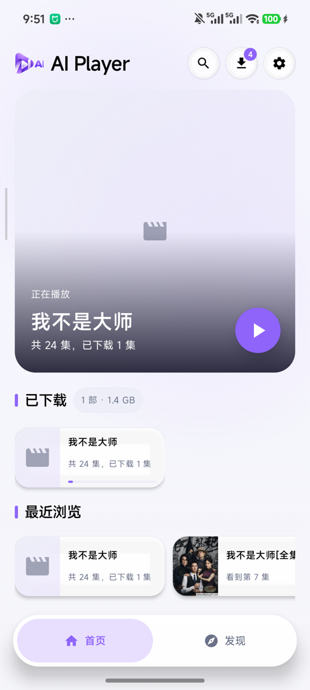
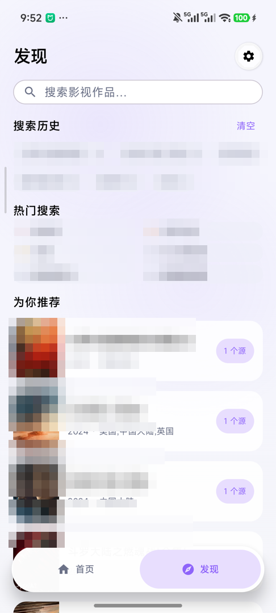
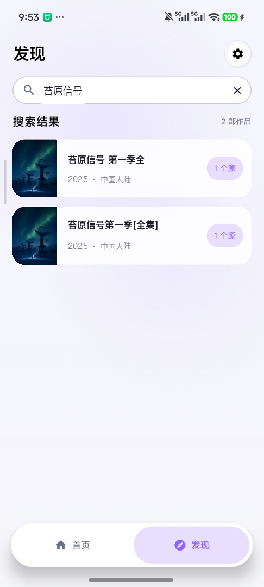
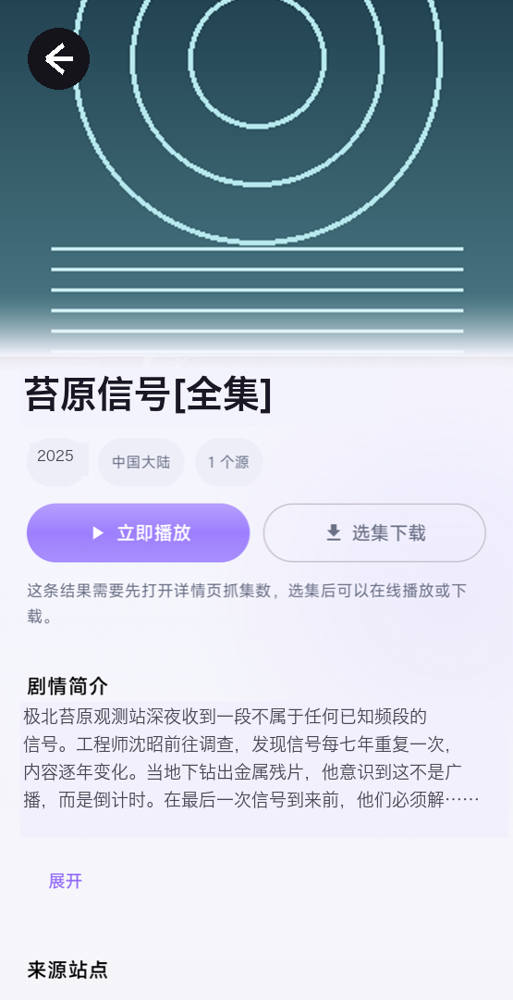
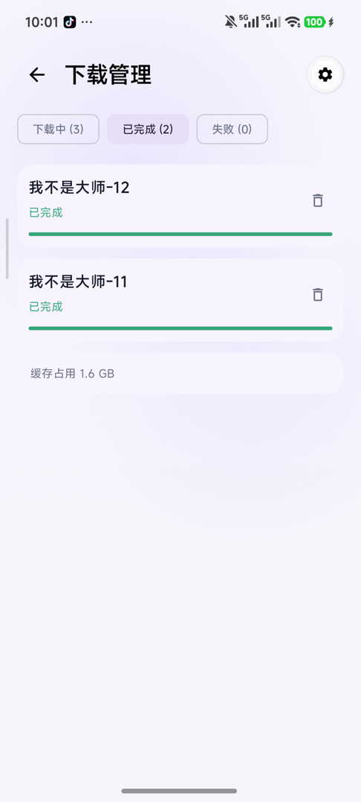
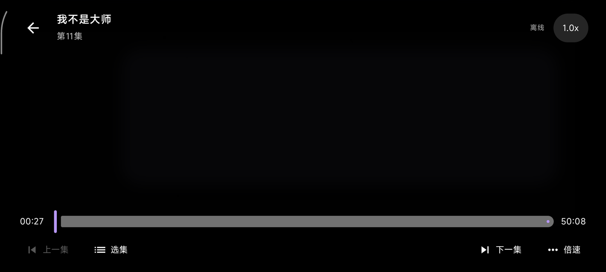

# AI Player

一个**免费、开源**的 Android 视频播放器：自带离线下载与播放缓存、跨源订阅搜索、横屏手势播放器，可选接入大模型让解析更省心，全部数据留在你的设备上。

**零遥测 · 零广告 · 482 个单元测试**

## ⚠️ 使用前必读

本仓库只提供**播放器与订阅框架**，不内置、不推荐、不附带任何视频源。首次运行时源列表为空，需要你自己添加订阅站点。你必须确保对所添加源的内容拥有合法访问权限；因使用本工具访问、下载、传播侵权内容而产生的一切后果由使用者自行承担。项目作者不对任何第三方站点的内容负责。

## 特性

- **跨源订阅搜索**：一次搜索并行请求所有已启用源，同名结果自动聚合（标注「N 个源」）；支持苹果 CMS（MacCMS）、帝国 CMS 与通用 HTML 站点，搜索规则自动探测并缓存。
- **离线下载**：基于 Media3 `DownloadManager`，SQLite 索引，杀进程后自动恢复；选集批量下载（多选 / 范围 `2-8` / 离散 `3,5`）、暂停续传、失败分类重试、WiFi/移动数据网络闸门、磁盘空间预判。
- **播放缓存秒开**：在线播放顺手写入离线缓存（命中不重复下载）；剧集详情页本地缓存，点击即开。
- **横屏播放器**：倍速、选集、前后 10 秒、断点续播、离线只读缓存模式。
- **大模型辅助（可选）**：名字里的 AI 落在实处——在设置里配置你自己的 DeepSeek API Key 后，大模型会在幕后接管难啃的站点：找搜索入口、给站点命名、提取搜索结果与集数，把「解析失败」变成「照常能用」。默认关闭，密钥只存本机，不生成任何内容。
- **动效设计**：海报共享元素转场、控制层淡入淡出、列表补位动画；尊重系统「移除动画」设置。
- **工程质量**：482 个 JVM 单元测试（解析、聚合、下载状态机等核心逻辑不依赖设备即可验证）；CI 每次提交全量构建 + 测试。

## 截图

| 首页 · 续播与下载概览 | 发现 · 搜索历史与推荐 | 跨源搜索结果 |
|:---:|:---:|:---:|
|  |  |  |

| 剧集详情 | 下载管理 | 横屏播放器 |
|:---:|:---:|:---:|
|  |  |  |

> 截图中的剧集、海报与简介均为**完全虚构的演示内容**（剧名经联网查重，不存在同名作品）；本仓库不内置任何视频源，源列表初始为空。

## 构建

环境：JDK 17、Android SDK（API 36）。

```bash
./gradlew :app:assembleDebug
```

APK 产物在 `app/build/outputs/apk/debug/app-debug.apk`。

运行单元测试：

```bash
./gradlew :app:testDebugUnitTest
```

最低系统版本 Android 8.0（API 26）。

## 添加订阅源

设置 → 订阅源 → 添加：填入站点首页地址即可。App 会自动探测该站的搜索规则（MacCMS 接口 / 帝国 CMS 表单 / 通用 HTML 搜索页），探测成功后规则缓存复用。

## 隐私

- 无任何遥测、统计、广告 SDK。
- 播放进度、下载记录、订阅源全部存储在本机。
- 仅两类出站请求：你配置的订阅站点；（可选、默认关闭）DeepSeek API。

## 许可证

AGPL-3.0-only · Copyright © 2026 AI Player Project contributors

选择 AGPL 的原因：任何人分发本程序的修改版（含服务端部署）必须同样开源，防止闭源套壳。

---

## English

**AI Player** is a free, open-source Android video player with built-in offline downloading, playback caching, and multi-source subscription search. Zero telemetry, zero ads, 482 unit tests.

The repository ships **no video sources** — the source list starts empty and you add your own sites at your own legal risk. The player framework supports MacCMS-style APIs, Empire CMS, and generic HTML sites, with automatic search-rule probing. The "AI" in the name is understated on purpose: bring your own DeepSeek API key (off by default, stored only on-device) and a large language model works behind the scenes — probing search entries, naming sites, extracting results and episode lists — turning "parse failed" into "just works". It generates no content and never decides what you watch.

Build with JDK 17 + Android SDK: `./gradlew :app:assembleDebug`. Licensed under AGPL-3.0-only.
